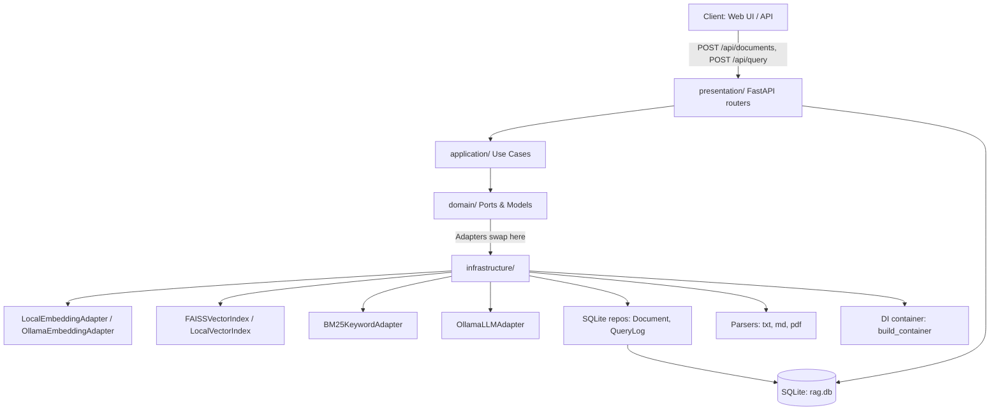

# Hybrid Document & Knowledge Assistant — Production RAG

A clean, modular, end-to-end **local RAG** assistant. Upload documents, ask grounded questions with **strict citations**, and view a full Q&A history — all running on your machine with **zero paid APIs or cloud services**.

---

## Quick start

```bash
# Backend (from the repo root)
python -m pip install -r requirements.txt
cd backend
uvicorn app:app --host 127.0.0.1 --port 8123
# API on http://localhost:8123  (health: GET /health)

# Frontend (optional, opens a UI on :5173)
cd frontend
npm install
npm run dev
```

> Environment notes
>
> - **Ollama or HuggingFace model downloads may be unavailable** in some
>   environments. The app still builds and every behavior is covered by an
>   offline, deterministic `pytest` suite (see [Tests](#tests)).
> - **Embedding**: by default uses a dedicated local model
>   (`BAAI/bge-small-en-v1.5`) via `fastembed`/`sentence-transformers`. If
>   neither is installed it falls back to a deterministic hashed embedding —
>   the chat LLM is **never** used to embed.
> - **Vector index**: FAISS when available, otherwise a pure-python cosine
>   brute-force index (`LocalVectorIndex`).
> - **BM25**: `rank_bm25` when installed, otherwise a pure-python BM25Okapi
>   implementation.
> - **Chat LLM**: defaults to Ollama (`qwen2.5:7b-instruct-q4_k_m`). Swap with
>   `OLLAMA_MODEL=gemma2` (or `llama3.1`, `deepseek-r1`, …) — no code changes.

## Architecture (Mermaid)



### Clean Architecture — layer breakdown

`backend/` is organized strictly by layer. Each layer depends **inward**; nothing
else. Swapping an adapter touches only `infrastructure/` + DI wiring.

- **`domain/`** — Pure business: Pydantic models (`DocumentRecord`,
  `ChunkRecord`, `SearchHit`, `Citation`, `AnswerResponse`, `QueryLogEntry`),
  exceptions, and abstract ports (`EmbeddingProvider`, `VectorIndex`,
  `KeywordIndex`, `LLMProvider`, `DocumentRepository`, `QueryLogRepository`).
  Zero framework/vendor imports.
- **`application/`** — Use cases:
  `IngestDocumentUseCase` (parse → chunk → embed → store + index),
  `HybridRetrieveUseCase` (dense + BM25 + Reciprocal Rank Fusion),
  `SynthesizeAnswerUseCase` (grounded synthesis, citations, abstention),
  `DeleteDocumentUseCase`, `ListHistoryUseCase`, plus pure helpers
  (`chunking.py`, `rrf.py`). Depends **only** on `domain/` ports.
- **`infrastructure/`** — Concrete adapters: `LocalEmbeddingAdapter`,
  `OllamaEmbeddingAdapter`, `FAISSVectorIndex`/`LocalVectorIndex`,
  `BM25KeywordAdapter`, `OllamaLLMAdapter`, `SQLiteDocumentRepository`,
  `SQLiteQueryLogRepository`, parsers (`.txt`, `.md`, `.pdf`), and the DI
  container (`di.py`).
- **`presentation/`** — FastAPI routers (`documents.py`, `query.py`,
  `history.py`, `health.py`), request/response schemas, HTTP error mapping.
  Calls application use cases only.

### Dedicated embedding vs. chat LLM

The system has **two separate models on purpose**:

1. **Embedding model** — a *dedicated* provider
   (`EMBEDDING_PROVIDER=local` default → `LocalEmbeddingAdapter`; or
   `EMBEDDING_PROVIDER=ollama` → `OllamaEmbeddingAdapter` hitting
   `/api/embeddings` with `nomic-embed-text`). It is used **only** to embed
   documents and queries into vectors. It is never the chat LLM.
2. **Chat LLM** — a *model-agnostic* local provider
   (`OllamaLLMAdapter`, default `qwen2.5:7b-instruct-q4_k_m`, swappable with
   `gemma2`, `deepseek-r1`, `llama3.1`, …) that synthesizes the grounded
   answer to your questions.

Reasons for the split: mixing them conflates two different jobs (semantic
indexing vs. conversational synthesis) and makes swapping one independently of
the other impossible. Here they are independent: change `EMBEDDING_PROVIDER`/
`OLLAMA_EMBED_MODEL` for embeddings; change `OLLAMA_MODEL` for answers.

### Smart chunking & hybrid retrieval

- **Chunking** (`application/chunking.py`): splits documents into
  `chunk_size` (default 500) word chunks with `overlap` (default 50),
  preserving rich metadata on every chunk: `doc_id`, `source_name`,
  `page_number` (when available), `section_heading` (Markdown headings /
  heading-like lines detected), and `chunk_index`.
- **Hybrid retrieval** (`application/retrieval.py` + `application/rrf.py`):
  runs **dense** vector search and **sparse** BM25 lexical search in parallel,
  then fuses the two ranked lists with **Reciprocal Rank Fusion**
  (`score = Σ 1/(60 + rank)`). Chunks found by only one method still appear;
  zero-hit queries and empty knowledge bases return `[]` without crashing.

### Grounding, citations & abstention

`SynthesizeAnswerUseCase` builds a numbered context from retrieved chunks and
instructs the LLM to answer **only** from that context, to cite inline as
`[1]`, `[2]`, … and to reply `ABSTAIN` when the evidence is insufficient. It
then parses the raw output (stripping `<think>…</think>` reasoning blocks and
Markdown fences), maps cited indices to exact chunks, and returns a
`Citation` per citation with `source_name`, `page_number`, `section_heading`,
`chunk_id`, and a snippet. When there is nothing to answer from, the system
abstains explicitly instead of fabricating.

## API endpoints

| Method | Path | Description |
| ------ | ---- | ----------- |
| POST | `/api/documents` | Upload a `.txt`/`.md`/`.pdf` file (multipart). |
| GET | `/api/documents` | List indexed documents. |
| DELETE | `/api/documents/{doc_id}` | Delete document + purge chunks from all indexes (`404` if missing). |
| POST | `/api/query` | Ask a grounded question (`{ "question": "...", "top_k"?: 1..50 }`). |
| GET | `/api/history` | List Q&A history (most recent first). |
| GET | `/health` | Health check. |

## Frontend

`frontend/` is a React app (Vite): upload/list/delete documents, ask grounded
questions, inspect cited sources/snippets, and view Q&A history.

```bash
cd frontend && npm install && npm run dev   # http://localhost:5173
# dev server proxies /api -> http://localhost:8123
```

## Configuration (`.env.example`)

Copy `.env.example` → `.env` and adjust. All keys default sensibly; see
[.env.example](.env.example).

## Tests (offline, deterministic)

```bash
cd backend && python -m pytest ../tests -q
# or from the repo root: python -m pytest tests -q
```

44 tests covering: parsing & ingestion edge cases (unsupported formats, empty /
whitespace-only files, corrupted PDFs, duplicate replacement), chunking &
metadata, RRF fusion, hybrid retrieval (union / sparse-only / dimension
mismatch / empty KB), grounded citations & abstention, delete/404 semantics,
API validation, and a full end-to-end flow with real (offline) adapters + a
fake LLM.

## Edge-case limitations (by design)

- **No paid services.** Local-only stack: embeddings are a dedicated local
  model; chat is local Ollama. If Ollama/HF downloads are unavailable,
  offline deterministic fallbacks keep the app fully functional for tests.
- **Scanned PDFs** (image-only, zero extractable text) are rejected with a
  clear 422 message. OCR is intentionally out of scope.
- **Deletion** cleans the vector index, keyword index, and chunk metadata, so
  no orphans remain; deleting a missing doc returns `404`.
- **Re-upload** of the same `source_name` deterministically replaces the old
  document (same `doc_id`, no duplicate chunks).
- **Abstention** relies on the LLM honoring the "answer only from context"
  prompt; out-of-range or nonexistent citations are dropped.
- **BM25/vector fallbacks** are offline-deterministic but approximate; for
  production quality install `fastembed`/`sentence-transformers` and
  `faiss-cpu`/`rank_bm25`.

## Swapping adapters (Strict Loose Coupling)

- Swap `EmbeddingProvider` / `VectorIndex` / `KeywordIndex` / `LLMProvider` by
  changing **one adapter in `infrastructure/`** and the factory in
  `infrastructure/di.py` — never `domain/` or `application/`.
- Change `EMBEDDING_MODEL` (and `EMBEDDING_PROVIDER`) in `.env` for a different
  embedding model; changing the dimension requires a rebuild of the index
  (a guard `EmbeddingDimensionError` is enforced).
- Change `OLLAMA_MODEL` (e.g. `gemma2`, `deepseek-r1`, `llama3.1`) for a
  different chat LLM.
